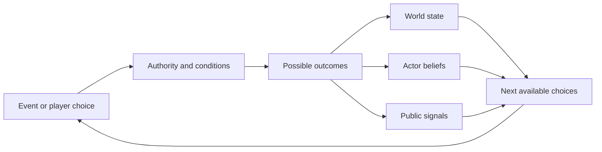

# Proposed state model

This is a design for the later game.
It is not a calibrated prediction system.
It defines 33 state variables, 10 role types, and 32 candidate transitions.
The [three example traces](example-traces.json) test coherent paths through the rules.

## Files

| File | Use |
| --- | --- |
| [Variables](variables.json) | Allowed values and meanings. |
| [Roles](roles.json) | Player choices and institutional limits. |
| [Transitions](transitions.json) | Conditions, outcomes, and evidence links. |
| [Example traces](example-traces.json) | Fictional paths with explicit outcomes. |
| [Incident template](incident-template.json) | Separate origin, operator, permission, and attribution. |
| [Metadata](model-metadata.json) | Scope, horizon, and resolution rules. |

## State has separate dimensions

Use a set of variables, not one escalation score.
A trade dispute, a cyber incident, and nuclear concern can change independently.
Every default value is `unknown`.
The examples assign fictional starting values. They are not a 2026 baseline.



The transition's `claim_ids` identify relevant research.
They do not prove its guards or effects.
Every transition is an explicit design assumption.

## Choice and event

A choice is an action available to the player.
An event is resolved by the scenario or facilitator.
An event can represent another actor's action, an accident, or new evidence.
The `actor_roles` field identifies the relevant roles.
It does not give the active player control of every listed role.

No transition has an assigned probability.
`null` means unknown. It does not mean zero or equal odds.
The outcome order is not a ranking of likelihood.

## Turn sequence

1. Deliver each actor's observations.
2. Record the actor's beliefs and information gaps.
3. Check role, office, legal authority, and available resources.
4. Show the permitted choices and their cited context.
5. Record a choice or resolve an external event.
6. Select a supported scenario outcome.
7. Apply its effects and record the time change.
8. Record harm, costs, and remaining uncertainty.

The prototype stores a single acting actor's belief values.
The future engine must store separate belief maps for all actors.
It must also store observation delays and private information.

## Choosing a person or entity

A person receives the powers of a dated office or corporate role.
An organization receives the powers of its institutions, with internal limits.
The game must check current office before each relevant choice.
Losing office removes that authority, but need not remove public influence.

An AI model is a capability by default.
To make an agent playable, define its tools, mandate, permissions, and control limits.
Do not grant it state authority because its developer is in that state.

## Two key safeguards for causal accuracy

The Taiwan example keeps these steps separate:

`election → proposal → legal process → firm response → supply effect → state response`.

The agent example keeps these steps separate:

`incident → evidence → attribution → public blame → political response`.

Either chain can stop or branch at several points.
See the [Taiwan dossier](../research/taiwan-chips/README.md) and [AI dossier](../research/ai-ecosystem/README.md).

## What remains for the game build

Add an event scheduler and separate actor belief stores.
Add role tenure, succession, institutional approval, and resource checks.
Add scenario-specific legal rules and delivery lags.
Add a user interface for choices and evidence.
Add an explicit public correction event after false blame.
Choose scoring rules for civilian harm, autonomy, prosperity, legitimacy, and security.
Do not optimize all actors against one shared score.

Use the same rules for peaceful and adverse outcomes.
Keep calibration files separate from the research corpus.
Validate any probabilities before presenting model output as a forecast.

## Validate the proposal

From the project folder, run:

```powershell
python wiki/tools/validate.py
```

The validator checks guards, effect values, reference IDs, and the example traces.
It also checks that narrow settlements preserve wider conflict.
It checks that containment, attribution, and civilian recovery remain separate.
It does not certify real-world causal validity.

[Wiki home](../README.md).
